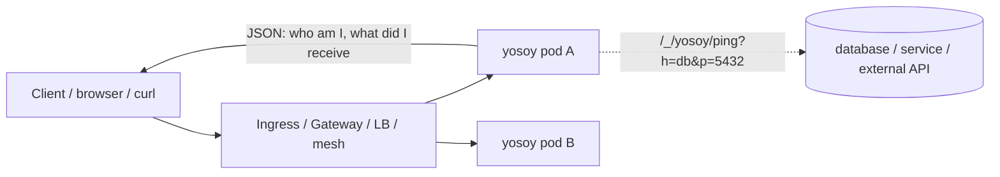

# yosoy  

**A tiny HTTP pod that tells you who it is, who called it, and what it can reach.**

yosoy is a single small Go binary (and Docker image) that you drop into a Kubernetes cluster, or any container platform, when you need to see what happens between a caller and a backend:

- **Who answered?** The pod hostname and a per-pod request counter.
- **What arrived?** Host, path, method, scheme, protocol, client IP and every header *after* your ingress, load balancer, auth gateway or service mesh has processed the request.
- **What can this pod reach?** A built-in reachability analyzer opens a connection from inside the pod to any `host:port`. Use it to check DNS, NetworkPolicies and egress firewalls.

It needs no configuration, responds to every path and method with JSON, and allows CORS. That means you can also call it from a browser frontend or use it as a placeholder backend while you prototype.

"Yo soy" means "I am" in Spanish.



## Quick start (Kubernetes)

```bash
# run yosoy and expose it as a ClusterIP service
kubectl run yosoy --image=lukasz/yosoy --port=80
kubectl expose pod yosoy --port=80

# what does a request look like by the time it reaches the pod?
kubectl run tmp --rm -i --restart=Never --image=curlimages/curl -- -s http://yosoy/hello

# can the yosoy pod reach the Kubernetes API server?
kubectl run tmp --rm -i --restart=Never --image=curlimages/curl -- -s "http://yosoy/_/yosoy/ping?h=kubernetes.default.svc&p=443"

# clean up
kubectl delete svc/yosoy pod/yosoy
```

There is also a fuller example using the Downward API in [Kubernetes example](#kubernetes-example).

## Typical use cases

| Question | What to look at |
|----------|-----------------|
| Does my Ingress / Gateway API route send this host and path to the right backend? Is the path rewritten? | `host`, `requestUri`, `hostname` |
| Is traffic spread evenly across replicas? Does session affinity work? | `hostname`, `counter` |
| Is the real client IP preserved (`externalTrafficPolicy`, `X-Forwarded-For`, PROXY headers)? | `remoteAddr`, `X-Forwarded-*` headers |
| Does my auth gateway / oauth2-proxy / mesh inject the expected identity headers? | `headers` |
| Is my CDN or HTTP cache actually caching? | `counter` stays the same when the cache answers |
| Can this pod reach that database, service or external API, or is DNS, a NetworkPolicy or a firewall in the way? | `/_/yosoy/ping` |
| Which labels, annotations or config files does the pod see? | `files` (via `YOSOY_SHOW_FILES`) |
| I need a backend stub *right now* that returns something more useful than the nginx welcome page. | everything above |

## How yosoy compares

Several good tools overlap with yosoy. Pick the one that fits the job:

| Tool | Best for |
|------|----------|
| **yosoy** | Request echo, pod identity and an in-pod reachability check in one small, zero-config image |
| [traefik/whoami](https://github.com/traefik/whoami) | Minimal request echo |
| [mccutchen/go-httpbin](https://github.com/mccutchen/go-httpbin) | The full httpbin API: controlled status codes, delays, payloads |
| [mendhak/http-https-echo](https://github.com/mendhak/docker-http-https-echo) | Request echo over both HTTP and HTTPS |
| [stefanprodan/podinfo](https://github.com/stefanprodan/podinfo) | A full demo microservice (metrics, Helm chart, many endpoints) for showcasing platform features |
| [nicolaka/netshoot](https://github.com/nicolaka/netshoot) | An interactive toolbox (`dig`, `tcpdump`, `curl`, ...) for `kubectl debug` sessions |

yosoy does **not** (yet) serve TLS / HTTP/2 or return controllable responses (status codes, delays). Both are planned, see [ROADMAP.md](ROADMAP.md).

## API

### Request and host introspection

Every request (any path except `/_/yosoy/*`, any method) gets a JSON response with:

- HTTP request:
  - Host
  - Request URI
  - Method
  - Scheme
  - Proto
  - URL
  - Remote IP (proxy headers such as `X-Forwarded-For` are taken into account)
  - HTTP headers
- host:
  - Hostname
  - How many times this instance has been called
  - Env variables if `YOSOY_SHOW_ENVS` is set to `true`, `yes`, `on`, or `1`
  - File contents if `YOSOY_SHOW_FILES` is set to a comma-separated list of (valid) files

`OPTIONS` requests get a permissive CORS preflight response, and every response sets `Access-Control-Allow-Origin: *`.

Check [Sample JSON response](#sample-json-response) for an example.

### ping/reachability analyzer

yosoy exposes a dedicated `/_/yosoy/ping` endpoint. It checks whether the yosoy instance can open a connection to a given endpoint, and accepts 4 query parameters:

* `h` - required - hostname of the endpoint
* `p` - required - port of the endpoint
* `n` - optional - network. All valid Go networks are supported (including `tcp`, `tcp4`, `tcp6`, `udp`, etc.). Defaults to `tcp`. An unknown network returns an error.
* `t` - optional - timeout in seconds. Defaults to `10`. An invalid integer returns an error.

It returns HTTP `200` when the connection succeeds, `400` for invalid parameters, and `500` with the underlying error (DNS failure, connection refused, timeout, ...) otherwise.

> [!NOTE]
> UDP is connectionless, so `n=udp` succeeds as soon as the address resolves. It does not prove the remote port is reachable.

Check [Sample ping/reachability analyzer responses](#sample-pingreachability-analyzer-responses) for examples.

## Configuration

| Environment variable | Default | Description |
|----------------------|---------|-------------|
| `YOSOY_SHOW_ENVS` | *(unset)* | When `true`, `yes`, `on` or `1`, include all environment variables in the response. |
| `YOSOY_SHOW_FILES` | *(unset)* | Comma-separated list of files whose contents are included in the response (e.g. Downward API volumes, ConfigMaps). Unreadable files are logged and skipped. |

yosoy listens on port `80`. A configurable port and non-root image are planned (see [ROADMAP.md](ROADMAP.md)).

## HTTP protocol support

yosoy serves **plaintext HTTP/1.1** (and HTTP/1.0) on port `80`. It does not terminate TLS or serve HTTP/2 itself.

When TLS is terminated by an ingress controller, load balancer or service mesh, the `proto` field shows the protocol *that proxy* used to talk to yosoy, typically `HTTP/1.1`. That is often exactly what you want to verify. Native TLS and h2c support are planned in [ROADMAP.md](ROADMAP.md).

## Security considerations

yosoy is a troubleshooting tool. It deliberately reveals information that a production service should not:

- **Environment variables:** with `YOSOY_SHOW_ENVS` enabled, any secret injected as an env variable (e.g. from a Kubernetes `Secret`) is returned to every caller.
- **Headers:** all request headers are echoed back verbatim, including `Authorization` and `Cookie`.
- **Reachability analyzer:** anyone who can reach yosoy can use `/_/yosoy/ping` to probe hosts and ports reachable from the pod.
- **CORS:** responses can be read by any website that can reach yosoy from a browser.

Run it in development and test environments, or briefly in production for troubleshooting. Don't expose it publicly, and remove it when you're done.

## Docker image

The Docker image is available on Docker Hub and ghcr.io:

```sh
docker pull lukasz/yosoy
docker pull ghcr.io/lukaszbudnik/yosoy
```

Tags: `latest` and semver tags (`3`, `3.1`, `3.1.0`) are published on releases. `edge` is built from every commit to `main`.

## Kubernetes example

There is a sample Kubernetes deployment file in the `test` folder. It uses both `YOSOY_SHOW_ENVS` and `YOSOY_SHOW_FILES`, and uses the Kubernetes Downward API to expose labels and annotations as volume files, which yosoy then returns.

Deploy it to minikube and call the service a couple of times:

```bash
# start minikube
minikube start
# deploy test service
kubectl apply -f test/deployment.yaml
# tunnel to it and copy the URL as $URL variable
minikube service --url camarero
# simulate some HTTP requests
curl -H "Host: gateway.myapp.com" $URL/camarero/abc
curl -H "Host: gateway.myapp.com" $URL/camarero/abc
curl -H "Host: gateway.myapp.com" $URL/camarero/abc
curl -H "Host: gateway.myapp.com" $URL/camarero/abc
```

## Sample JSON response

A sample yosoy JSON response to a request made from a single page application (SPA) to a backend API deployed in Kubernetes behind nginx ingress and [haproxy-auth-gateway](https://github.com/lukaszbudnik/haproxy-auth-gateway) looks like this:

```json
{
  "host": "api.localtest.me",
  "proto": "HTTP/1.1",
  "method": "GET",
  "scheme": "https",
  "requestUri": "/camarero",
  "url": "https:///camarero",
  "remoteAddr": "192.168.65.3",
  "counter": 1,
  "headers": {
    "Accept": ["*/*"],
    "Accept-Encoding": ["gzip, deflate, br"],
    "Accept-Language": ["en-US,en;q=0.9,pl-PL;q=0.8,pl;q=0.7,es;q=0.6"],
    "Authorization": [
      "Bearer eyJhbGciOiJSUzI1NiIsInR5cCIgOiAiSldUIiwia2lkIiA6ICJXejFuaDNCWDI4UHMxVEMzSDRoOW52Q1VWRXpjVVBzQms4Z1NmeEp4ZS1JIn0.eyJleHAiOjE2Mjk4MjM3OTMsImlhdCI6MTYyOTgyMjg5MywiYXV0aF90aW1lIjoxNjI5ODIyODkyLCJqdGkiOiI3ZmQzMjkwZi05NjMyLTQ0NzEtYjRjOS1lNTFjZDYwMjllYjgiLCJpc3MiOiJodHRwczovL2F1dGgubG9jYWx0ZXN0Lm1lL2F1dGgvcmVhbG1zL2hvdGVsIiwic3ViIjoiMDdmYzM3YmYtMmJjNy00ZTRmLWE3MDUtYzRjNjgzNTIwYmU1IiwidHlwIjoiQmVhcmVyIiwiYXpwIjoicmVhY3QiLCJub25jZSI6IjQzNDhmMjU5LTliYTYtNDk2ZC04N2I5LWZmZGYzNDMwN2UzOSIsInNlc3Npb25fc3RhdGUiOiJmNTM5OGI3Ny01OTNhLTQ3OWYtOTc5NS00NGIyNGJjMjhkYjQiLCJhY3IiOiIxIiwiYWxsb3dlZC1vcmlnaW5zIjpbImh0dHBzOi8vbHVrYXN6YnVkbmlrLmdpdGh1Yi5pbyJdLCJyZWFsbV9hY2Nlc3MiOnsicm9sZXMiOlsiY2FtYXJlcm8iXX0sInNjb3BlIjoib3BlbmlkIGVtYWlsIHByb2ZpbGUiLCJzaWQiOiJmNTM5OGI3Ny01OTNhLTQ3OWYtOTc5NS00NGIyNGJjMjhkYjQiLCJlbWFpbF92ZXJpZmllZCI6ZmFsc2UsIm5hbWUiOiJKdWxpbyIsInByZWZlcnJlZF91c2VybmFtZSI6Imp1bGlvIiwiZ2l2ZW5fbmFtZSI6Ikp1bGlvIn0.t5y3L4FzGxM0zwI3fskDI8Kemxz_izcvPPKciSEvNHnZWGQK-9AclGNFz_A9cLFSkpc6l6lBmt7WaC0i04c4h1a9G9AOFImmVXPMPDdTXOQ4aah4CvlN6Fy8ShvSHrQA-wMHEELBpIFsKFx2WP3QHiy27ycr3kqQzW4QymyU7J8tM4-qKR_H1_8aiNOrm5fIED-nEP096V2zvWXiGZX7ts6XE2-annhKphCABLdmIiwgDUnhlAz0hdiDrDbIjzr0ldW4AnUkSQxIZY0PnoEnGVuUvkOYvJpFx10gjORMnRgHSEj9Mk5dtyVGHcihZ5TntCL40WoymNxae6K4-FH3Lw"
    ],
    "Origin": ["https://lukaszbudnik.github.io"],
    "Referer": ["https://lukaszbudnik.github.io/"],
    "Sec-Ch-Ua": [
      "\" Not;A Brand\";v=\"99\", \"Google Chrome\";v=\"91\", \"Chromium\";v=\"91\""
    ],
    "Sec-Ch-Ua-Mobile": ["?0"],
    "Sec-Fetch-Dest": ["empty"],
    "Sec-Fetch-Mode": ["cors"],
    "Sec-Fetch-Site": ["cross-site"],
    "User-Agent": [
      "Mozilla/5.0 (Macintosh; Intel Mac OS X 10_15_7) AppleWebKit/537.36 (KHTML, like Gecko) Chrome/91.0.4472.114 Safari/537.36"
    ],
    "X-Forwarded-For": ["192.168.65.3", "10.1.3.9"],
    "X-Forwarded-Host": ["api.localtest.me"],
    "X-Forwarded-Port": ["443"],
    "X-Forwarded-Proto": ["https"],
    "X-Real-Ip": ["192.168.65.3"],
    "X-Request-Id": ["48a77564d88ca8a893610b9458bfd885"],
    "X-Scheme": ["https"]
  },
  "hostname": "camarero-cf7c95ccd-cz5lh",
  "envVariables": [
    "PATH=/usr/local/sbin:/usr/local/bin:/usr/sbin:/usr/bin:/sbin:/bin",
    "HOSTNAME=camarero-cf7c95ccd-cz5lh",
    "YOSOY_SHOW_FILES=/etc/podinfo/labels,/etc/podinfo/annotations",
    "YOSOY_SHOW_ENVS=true",
    "KUBERNETES_SERVICE_PORT=443",
    "KUBERNETES_PORT_443_TCP=tcp://10.96.0.1:443",
    "KUBERNETES_PORT=tcp://10.96.0.1:443",
    "KUBERNETES_PORT_443_TCP_PORT=443",
    "KUBERNETES_SERVICE_HOST=10.96.0.1",
    "KUBERNETES_PORT_443_TCP_PROTO=tcp",
    "KUBERNETES_PORT_443_TCP_ADDR=10.96.0.1",
    "HOME=/root"
  ],
  "files": {
    "/etc/podinfo/annotations": "kubernetes.io/config.seen=\"2021-08-24T15:12:19.555374430Z\"\nkubernetes.io/config.source=\"api\"",
    "/etc/podinfo/labels": "app.kubernetes.io/component=\"api\"\napp.kubernetes.io/name=\"camarero\"\napp.kubernetes.io/part-of=\"hotel\"\napp.kubernetes.io/version=\"0.0.1\"\npod-template-hash=\"cf7c95ccd\""
  }
}
```

## Sample ping/reachability analyzer responses

To test if yosoy can connect to `google.com` on port `443` using default `tcp` network use the following command:

```bash
curl -v "http://localhost/_/yosoy/ping?h=google.com&p=443"
> GET /_/yosoy/ping?h=google.com&p=443 HTTP/1.1
> Host: localhost
> User-Agent: curl/7.86.0
> Accept: */*
>
< HTTP/1.1 200 OK
< Date: Fri, 17 Nov 2023 05:54:36 GMT
< Content-Length: 29
< Content-Type: text/plain; charset=utf-8
<
{"message":"ping succeeded"}
```

To see an unsuccessful response you may use localhost with some random port number:

```bash
curl -v "http://localhost/_/yosoy/ping?h=127.0.0.1&p=12345"
> GET /_/yosoy/ping?h=127.0.0.1&p=12345 HTTP/1.1
> Host: localhost
> User-Agent: curl/7.86.0
> Accept: */*
>
< HTTP/1.1 500 Internal Server Error
< Date: Fri, 17 Nov 2023 05:53:48 GMT
< Content-Length: 66
< Content-Type: text/plain; charset=utf-8
<
{"error":"dial tcp 127.0.0.1:12345: connect: connection refused"}
```

> [!NOTE]
> The body is JSON, but the `Content-Type` header is currently `text/plain`. This is a known bug tracked as item 1.2 in [ROADMAP.md](ROADMAP.md).

## Building and testing locally

Run tests and start yosoy directly on port 80:

```bash
go vet ./...
go test -race -coverprofile cover.out ./...
go tool cover -html=cover.out
go run server.go
```

Build a local Docker image and run it on port 8080:

```bash
docker build -t yosoy-local:latest .
docker run --rm --name yosoy-local -p 8080:80 yosoy-local:latest
```

## Contributing and roadmap

Contributions are welcome, including AI-assisted ones. Please read [CONTRIBUTING.md](CONTRIBUTING.md) first. Planned work is tracked in [ROADMAP.md](ROADMAP.md).
